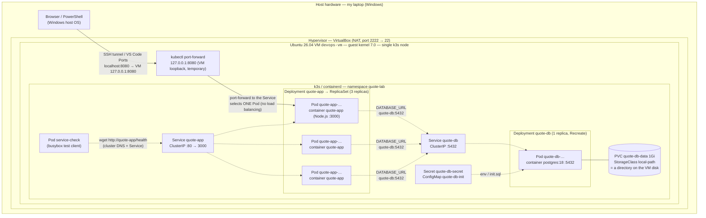

# Lab 52 — Architecture notes

## Current architecture

Legend:
- **Boxes inside boxes** = "runs inside" boundaries (hardware → hypervisor → VM → k3s → Pods → containers).
- **Solid arrows** = traffic path used from my laptop.
- **Dashed arrows** = in-cluster traffic paths.

> PostgreSQL status: **deployed and verified** / **planned** ← keep the one that is true.

## Evidence

- Lab 42 verification (health requests, 3 replicas, Pod replacement, readiness failure/recovery): [../42-kubernetes/verification.md](../42-kubernetes/verification.md)
- PVC status: `quote-db-data   Bound   …` ← paste
- Database Pod before replacement: `quote-db-…` ← paste
- Database Pod after `rollout restart`: `quote-db-…` ← paste
- Quote marker: `res509-…` found before **and** after the database Pod replacement ← paste the two `grep` results

## Boundaries

**Shared kernel.** All containers on this node (app and PostgreSQL) are Linux processes isolated by namespaces and cgroups, but they share the Ubuntu VM's guest kernel; the hypervisor (VirtualBox) provides the stronger VM boundary, and Kubernetes only manages workloads inside that VM.

**Persistence and failure boundary.** App Pods are stateless, so the ReplicaSet can replace one with a new name without losing anything; the quote survives a database Pod replacement because the data lives in the PVC, not in the container, and the new Pod mounts the same volume. However, the three replicas and the `local-path` volume all live on one VM and one disk: losing the VM or its disk loses every replica and the data, so recovery from that would need backups and a multi-node / replicated storage design, which this teaching cluster does not provide (future work).

## Next action / main limitation

- ← e.g. "Single node and local-path storage are single points of failure; next step: database backups." or the current blocker if something is unfinished.