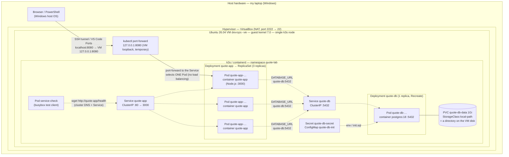

# Lab 52 — Architecture notes

## Current architecture

Legend:
- **Boxes inside boxes** = "runs inside" boundaries (hardware → hypervisor → VM → k3s → Pods → containers).
- **Solid arrows** = traffic path used from my laptop.
- **Dashed arrows** = in-cluster traffic paths.



> PostgreSQL status: **deployed** (manifests applied on 2026-10-19). Persistence check: **TODO — mark "verified" only after section Evidence is filled with real output.**

## Evidence

- Lab 42 results (health requests, 3 replicas, Pod replacement, readiness failure/recovery): [../42-kubernetes/verification.md](../42-kubernetes/verification.md)

**PVC and database Pod**

```
$ kubectl get pvc quote-db-data
TODO quote-db-data   Bound   pvc-...   1Gi   RWO   local-path

$ kubectl get pods -l app=quote-db
TODO quote-db-<old>   1/1   Running
```

**Quote inserted through the app** (port-forward `svc/quote-app 8080:80`)

```
$ quote_marker="res509-$(date +%s)"; echo "$quote_marker"
TODO res509-...
$ curl --fail --data-urlencode "author=RES509" --data-urlencode "text=$quote_marker" http://127.0.0.1:8080/quotes
$ curl --fail http://127.0.0.1:8080/ -o /tmp/res509-quotes.html && grep -F "$quote_marker" /tmp/res509-quotes.html
TODO <line containing res509-...>
```

**After database Pod replacement (same PVC)**

```
$ kubectl rollout restart deployment/quote-db && kubectl rollout status deployment/quote-db --timeout=180s
$ kubectl get pods -l app=quote-db
TODO quote-db-<new>   1/1   Running
$ curl --fail http://127.0.0.1:8080/ -o /tmp/res509-quotes-after.html && grep -F "$quote_marker" /tmp/res509-quotes-after.html
TODO <same line containing res509-...>
```

Result: old Pod `TODO` → new Pod `TODO`; the marker is found before **and** after → the data lives in the PVC, not in the container.

> If this check cannot be completed: replace the block above with the last successful checkpoint (e.g. "PVC Bound and quote-db 1/1") and the actual blocker.

## Boundaries

**Shared kernel.** All containers on this node (app and PostgreSQL) are Linux processes isolated by namespaces and cgroups, but they share the Ubuntu VM's guest kernel; the hypervisor (VirtualBox) provides the stronger VM boundary, and Kubernetes only manages workloads inside that VM.

**Persistence and failure boundary.** App Pods are stateless, so the ReplicaSet can replace one with a new name without losing anything; the quote survives a database Pod replacement because the data lives in the PVC, not in the container, and the new Pod mounts the same volume. However, the three replicas and the `local-path` volume all live on one VM and one disk: losing the VM or its disk loses every replica and the data, so recovery from that would need backups and a multi-node / replicated storage design, which this teaching cluster does not provide (future work).

## Next action / main limitation

- **Main limitation:** the whole system runs on one VM with `local-path` storage, so the node and its disk are single points of failure: three app replicas protect against a Pod crash, not against losing the VM.
- **Next action:** add database backups (e.g. a scheduled `pg_dump` stored outside the VM) before considering a multi-node cluster with replicated storage (Lab 62).